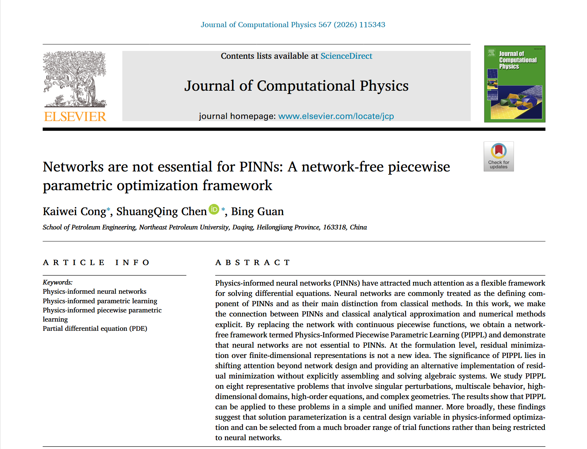
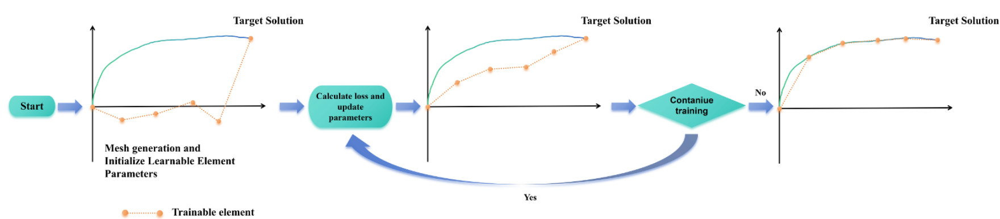

这是一篇讨论性质的论文，从论文的标题就可以看出，论文标题为“网络并非PINNs的必需：PINN是一种无网络分段参数优化框架”。

# Networks are not essential for PINNs: A network-free piecewise parametric optimization framework

我们先来看看这篇论文的摘要：

## 摘要

英文原文：

Physics-informed neural networks (PINNs) have attracted much attention as a flexible framework for solving differential equations. Neural networks are commonly treated as the defining component of PINNs and as their main distinction from classical methods. In this work, we make the connection between PINNs and classical analytical approximation and numerical methods explicit. By replacing the network with continuous piecewise functions, we obtain a networkfree framework termed Physics-Informed Piecewise Parametric Learning (PIPPL) and demonstrate that neural networks are not essential to PINNs. At the formulation level, residual minimization over finite-dimensional representations is not a new idea. The significance of PIPPL lies in shifting attention beyond network design and providing an alternative implementation of residual minimization without explicitly assembling and solving algebraic systems. We study PIPPL on eight representative problems that involve singular perturbations, multiscale behavior, highdimensional domains, high-order equations, and complex geometries. The results show that PIPPL can be applied to these problems in a simple and unified manner. More broadly, these findings suggest that solution parameterization is a central design variable in physics-informed optimization and can be selected from a much broader range of trial functions rather than being restricted to neural networks.

翻译：

物理知情神经网络（PINN）作为一种灵活的微分方程求解框架，备受关注。神经网络通常被视为PINNs的定义成分，也是其与传统方法的主要区别。在本研究中，我们明确阐明了PINNs与经典解析近似及数值方法之间的联系。通过用连续分段函数替代网络，我们得到了一个无网络的框架，称为物理知情分段参数学习（PIPPL），并证明神经网络并非PINNs的必需。在表述层面，有限维表示的残差最小化并非新思想。PIPPL的重要性在于将注意力从网络设计转向，提供一种在不明确组装和求解代数系统的情况下实现残差最小化的替代方法。我们研究PIPPL涉及奇异扰动、多尺度行为、高维域、高阶方程和复几何的八个代表性问题。结果表明，PIPPL可以简单统一地应用于这些问题。更广泛地说，这些发现表明解参数化是物理驱动优化中的核心设计变量，可以从更广泛的试验函数中选择，而非局限于神经网络。

<!-- truncate -->

## 介绍

微分方程的数值解在科学计算和工程应用中起着核心作用[1]。近几十年来，广泛采用了两种广泛的范式：基于离散化的经典方法和机器学习方法[2]。

作为一种代表性的经典离散化方法，有限元法（FEM）已发展成为通过域离散化求解微分方程的系统框架[3,4]。在有限元法及相关方法中，解通常通过网格上的局部基函数近似，原始微分方程通过变分或加权残差形式转换为离散代数系统。该框架提供了清晰的数学结构、强有力的理论支持和广泛的应用性。

然而，在高度非线性、多尺度、奇异扰动或高维问题中，有限元法及相关方法的实际性能可能不太理想[5–7]。在这种情况下，这些方法的构建和应用可能会变得更加复杂或昂贵。例如，在高维空间中，自由度的快速增长以及组装和求解大型代数系统的需求可能成为主要的计算瓶颈[7]。

与此同时，当基于离散化的经典方法难以构建或成本高昂时，机器学习方法也作为求解微分方程的替代工具出现了[8,9]。其中，物理知情神经网络（PINN）已成为一种流行且灵活的工具，利用神经网络表示解，无需显式网格生成[10,11]。原则上，PINNs可以通过修改网络的输入输出维数和损耗函数的形式，应用于多种不同类型的微分方程。这对于复杂几何或高维度问题尤其有吸引力，因为传统方法通常需要复杂的网格设计。从概念上讲，PINN提供了一个相对简单统一的框架，并且在许多非线性和高维问题中展现出潜力。

然而，PINNs常常存在训练不稳定性和收敛失败的问题，尤其是在单扰动或多尺度问题时[12–15]。它们的性能高度依赖于架构、激活函数、超参数、采样和优化策略之间的相互作用，而严格的错误控制和物理可解释性则有限。提出了许多改进方案，包括域分解[16]、高级训练策略[17]、修改架构[18]以及混合表述[12]，以提升不同场景下的性能。

尽管这些方法能够缓解具体难题，但它们仍然主要依赖神经网络来参数化解。神经网络的理论近似能力并不保证特定的有限架构和训练配置都能被优化，从而为每个问题提供准确的解决方案。实际上，获得可靠的PINN解决方案通常需要复杂的组合和反复调整。因此，PINN表面上简单统一的表述，在应用于单个问题时，可能导致复杂的算法设计和调优过程。

因此，一个自然的问题是，是否可以结合有限元法和PINN的优点，同时避免它们各自的一些缺点。现有的FEM与PINN结合尝试主要沿用三个方向：利用神经网络辅助有限元求解器，将FEM元素引入PINN框架，或设计旨在模拟有限元近似的网络结构[19–22]。在这些方法中，神经网络仍然是解决问题的核心组成部分。然而，一些近期研究质疑网络是否能可靠地重现有限元近似[22]。近年来，一些研究开始超越将神经网络作为全局解映射的使用，转而将其作为局部支持的表示方式，或将其作用限制在解法过程的特定阶段[23,24]。

本研究探讨了FEM与PINN界面上较少研究的方向。我们将PINN视为包含解参数化和基于物理的参数识别，这使其与经典解析近似和数值方法的联系显而易见。具体来说，我们用连续分段函数替代神经网络，并利用反向传播直接优化残余损耗下的自由度，形成了一个无网络框架，称为物理知情分段参数学习（PIPPL）。

在表述层面，有限维分段表示上的残差最小化在概念上并不新鲜。然而，与标准PINN相比，PIPPL提供了更明确、更局部化的解决方案表示，无需依赖网络架构或激活函数选择。与传统有限元法相比，它保留了PINNs的参数识别工作流程，而无需明确推导弱公式或组装和求解传统的离散代数系统。因此，PIPPL将局部的FEM表示与PINNs的灵活参数识别过程结合起来。

为了研究PIPPL，我们考虑了一系列代表性的常微分方程（ODE）和偏微分方程（PDE）问题，包括奇异扰动、强非线性、延迟、高维、多尺度、高阶和几何复杂情况。结果表明，PIPPL能够在简单训练环境中实现准确且稳定的解，并且在多个条件下，相较于标准PINN和FEM基线，在准确性、稳定性和计算成本之间提供了有利的平衡。综合来看，这些结果表明，解参数化应作为物理驱动优化中的独立设计变量。它可以适应不同问题的特性，可能的选择不仅限于神经网络，还能覆盖更广泛的试验功能。

本文其余部分的组织如下。第二节介绍了PIPPL框架的制定。第三节描述了实验设置和数值结果。第四部分讨论了该框架的方法论意义、实际优势及当前局限性。最后，第5节总结了主要发现，并为未来研究提供了方向。

## 方法论

我们从参数优化的角度开发本方法。考虑一个以一般形式写成的微分方程

$$
\mathcal{N} [u](x)=f(x),\qquad x\in \Omega ,\tag{1}
$$

连同边界或初始条件

$$B\left[ u \right] \left( x \right) =g\left( x \right) ,x\in \partial \Omega .\tag{2}$$

PINN 并不直接确定未知函数 u。相反，它首先引入了一个有限维试用函数 $u_θ(x)$ ，其中神经网络定义了泛函形式，θ表示其可训练参数。这一步将对未知函数的搜索转换为参数化候选函数族内的搜索，因此可视为解参数化。

图1 拟议PIPPL框架的整体工作流程，展示了网格生成、元素初始化（参数初始化）、损失计算和参数优化的过程。

然后用$u_θ$计算控制方程及边界或初始条件，构造基于残差的目标，通常写为

$$
\mathcal{L} (\boldsymbol{\theta })=\frac{1}{N_r}\sum_{i=1}^{N_r}{\bigl| \mathcal{N} [u_{\boldsymbol{\theta }}](\boldsymbol{x}_i)-f(\boldsymbol{x}_i) \bigr| ^2} +\frac{1}{N_b}\sum_{j=1}^{N_b}{\bigl| B[u_{\boldsymbol{\theta }}](\boldsymbol{x}_j)-g(\boldsymbol{x}_j) \bigr| ^2.}
$$

随后采用基于梯度的优化方法来确定参数向量

$$\theta ^*=*argmin_{\theta}\mathcal{L} (\theta ).$$

第二步可以被视为参数识别。因此，PINN的基本过程可以分解为两个过程：选择参数化的试函数，并根据物理残差确定其参数。

基于这一观点，我们使用“物理知情参数学习”（PIPL）一词来描述通过物理目标识别参数化解表示的更广泛方法类。PIPPL是本工作中开发的PIPL的具体实现，也可以视为PINNs背后的优化框架的无网络扩展。

在PIPPL中，目标解由一组局部低阶分段参数函数表示，相关的离散参数直接被视为可训练变量。通过最小化损失函数，这些参数会迭代更新，使分段表示趋近于目标解。通过这种方式，PIPPL既隔离了标准PINN框架中解参数化的作用，也提供了一种简单的无网络方法，展示了神经网络并非唯一可能的表示选择。PIPPL的整体工作流程如图1所示。网格生成和参数初始化后，进行损耗计算和参数优化。

### 一维常微分方程问题的示意

为了说明PIPPL的基本思想和实现，我们首先考虑一个简单的一维（1D）示例。具体来说，我们使用奇异扰动一维问题[25]：

$$\varepsilon f^{\prime}(x)+f(x)-1=0,\qquad x\in [0,1],\tag{5}$$

条件为

$$f(0)=0,\qquad f(1)=1.\tag{6}$$

虽然该方程看似简单，但当$ε$较小时，由于边界$x = 0$附近形成了薄边界层，因此计算变得越来越困难。

#### 步骤1：网格生成与参数初始化

对于式（5），PIPPL表示通过N个分段线性元素在[0， 1]上的解。等价地，该表示具有N+1个节点值。由于这两个边界值由边界条件固定，只有N−1个内部节点值可调成。从这个意义上说，N控制元素数量或所谓的分辨率，而N−1是当前一维环境中可训练参数的数量。

区间 [0， 1] 被划分为 N 个线性元素，节点为

$$x_0=0,x_1,...,x_N=1.$$

在本研究中，我们为所有情况使用统一网格。设 $y_i$ 表示为 $x_i$ 相关的节点值。为了硬性地施加边界条件，我们将两个端点值固定为

$$y_0=0,\qquad y_N=1,$$

并且只处理内部节点值

$$\{y_1,y_2,...,y_{N-1}\}$$

并且只将内部节点值视为可训练参数。因此，边界条件在整个训练过程中均被完全满足。在实际操作中，可训练的内部参数通过小的随机扰动初始化，例如

$$y_j\sim \mathcal{N} (0,0.1^2),\qquad j=1,2,...,N=1. \tag{7}$$

#### 步骤2：分段线性表示

在每个元素 $[x_i， x_{i+1}]$中，$i = 0， 1， ... ， N − 1$，局部表示由两个端点值 $y_i$ 和 $y_{i+1}$ 定义。这种构造对当前问题尤为方便，因为式（5）的残差涉及一阶导数，分段线性形式为每个元素的导数提供了简单的显式表达式。其坡度为

$$k_i=\frac{y_{i+1}-y_i}{x_{i+1}-x_i},\tag{8}$$

这也是逐元素导数近似。局部近似则为

$$f(x)=k_i(x-x_i)+y_i,\qquad x\in [x_i,x_{i+1}]. \tag{9}$$

这给出了一个全局连续的分段线性近似，因为相邻元素在共同界面共享相同的节点值。

#### 第三步：物理学基础的残差损失

为了强制执行方程（5），我们构造了N个元素上的残差损耗。在当前实现中，残差在每个元素的中点逐点计算。

对于元素 $[x_i，x_{i+1}]$，设

$$x_{\mathrm{mid},i}=\frac{x_i+x_{i+1}}{2}$$

成为其中点。由于近似对每个元素都是线性的，其导数在该处是常数：

$$f^{\prime}\left( x \right) =k_i,x\in \left[ x_i,x_{i+1} \right] .$$

因此，元素间残差定义为

$$r_i=\varepsilon k_i+f(x_{\mathrm{mid},i})-1,\tag{10}$$

其中

$$f(x_{\mathrm{mid},i})=k_i(x_{\mathrm{mid},i}-x_i)+y_i.\tag{11}$$

总残差损耗取为所有元素的均方中点残差：

$$\mathcal L=\frac{1}{N}\sum_{i=0}^{N-1}{r_{i}^{2}.}\tag{12}$$

因此，当前表述对应于对微分残差的元素中点共配处理。残差直接通过分段参数表示的逐点求值定义。

#### 步骤4：基于梯度的优化

可训练的内部节点值由如Adam[26]等优化器直接优化。每次迭代时，参数会根据以下方式更新

$$y_{j}^{\mathrm{new}}=y_{j}^{\mathrm{old}}-\eta \frac{\partial \mathcal{L}}{\partial y_j},\tag{13}$$

其中，$η$是学习率。通过反复更新，分段表示逐渐调整到一个既满足支配方程又完全保持边界条件的解。

本例说明了PIPPL的基本机制。解以显式分段参数形式表示，相关参数则直接在基于物理的约束下进行优化。无需显式代数系统、矩阵组装、标记数据、域分解策略或神经网络架构。

### PDE问题的示意

通过上述常微分方程的例子，PIPPL的基本思想、表述和训练过程已经被阐明。在本PDE示例中，我们的主要目的是展示如何将同一框架推广到PDE问题，以及高阶导数如何在PIPPL中表示。为了说明这一扩展，我们考虑以下两个空间维度的时变对流扩散方程：

$$u_t+au_x+bu_y-\kappa \left( u_{xx}+u_{yy} \right) =f(x,y,t),\qquad (x,y,t)\in \Omega \times [0,T],\tag{14}$$

其中，a和b是对流系数，$κ>0$是扩散系数，$f$是规定的源项。

#### 步骤1：通过辅助变量约简为一阶系统

为了处理二阶空间导数 $u_{xx}$ 和 $u_{yy}$，我们引入了辅助变量

$$p=u_x,\qquad q=u_y, \tag{15}$$

因此，方程（14）被重写为等价的一阶系统

$$u_t+ap+bq-\kappa \left( p_x+q_y \right) =f\left( x,y,t \right) .\tag{16}$$

因此，偏微分方程可以通过残差来强制执行

$$r_1=p-u_x,\qquad r_2=q-u_y,\qquad r_3=u_t+ap+bq-\kappa ({p}_x+{q}_y)-f.$$

这样，高阶导数的处理被简化为构造一阶系统，并可以类似常微分方程示例所示的方式处理。特别地，$p$ 和 $q$ 被视为独立的可训练场，具有各自的参数表示，它们与 $u_x$ 和 $u_y$ 的一致性通过剩余约束 $r_1$ 和 $r_2$ 来强制执行。

#### 步骤2：时空划分及参数初始化

与常微分方程中单一参数N控制一维区间划分不同，偏微分方程情况需要不同坐标方向上的独立解析参数。对于当前的二维时间相关问题，我们使用

$$\left( N_x,N_y,N_t \right) ,$$

分别表示x方向、y方向和t方向上的节点数量。因此，它们确定了时空划分，并直接控制参数表示的大小。完整的时空域被划分为

$$\left( N_x-1 \right) \left( N_y-1 \right) \left( N_t-1 \right) $$

矩形时空单元。对于主场u，时空网格中的每个点都关联一个节点参数。在当前实现中，初始条件和 u 的边界条件作为硬约束被强加。因此，位于受限初始或边界曲面上的 u 节点值事先固定，只有剩余的内部节点值可训练。

在当前实现中，p 和 q 都表示在整个时空网格上，节点值被视为可训练参数。因此，可训练参数的总数由$(N_x,N_y,N_t)$和辅助场数共同控制。

更具体地说，对于当前的二维例子，这给出了你内部节点值（可训练参数）的计数：

$$N_{u}^{int}=\left( N_x-2 \right) \left( N_y-2 \right) \left( N_t-1 \right) ,$$

其中,因子$N_{t − 1}$反映出只有初始条件在时间上是固定的，而每个空间方向都贡献一个形如$N_{i−2}$的因子，因为边界的两侧都是固定的。每个辅助场贡献$N_xN_yN_t$可训练节点参数，可训练参数总数为

$$N_{\text{train}} = (N_x - 2)(N_y - 2)(N_t - 1) + 2N_x N_y N_t \quad (18)$$

#### 步骤 3：分段线性表示与辅助变量及导数的评估

引入时空划分后，每个场（$u$、$p$ 和 $q$）在连续时空网格上通过三线性分段参数形式局部表示。因此，ODE 示例中使用的、一维分段线性构造被直接扩展到了三维时空网格 $(x, y, t)$。考虑一个局部网格

$$[x_i, x_{i+1}] \times [y_j, y_{j+1}] \times [t_k, t_{k+1}].$$

场 $u$、$p$ 和 $q$ 中的每一个在该网格中由其在八个角节点上的值确定。例如，$u$ 的局部表示由八个节点参数确定
$$u_{i,j,k}, \ u_{i+1,j,k}, \ u_{i,j+1,k}, \ u_{i+1,j+1,k}, \ u_{i,j,k+1}, \ u_{i+1,j,k+1}, \ u_{i,j+1,k+1}, \ u_{i+1,j+1,k+1},$$

对于 $p$ 和 $q$ 也是如此。主场 $u$ 以及辅助场 $p$ 和 $q$ 表示在相同的时空划分上，但具有独立的节点参数集。因此，它们共享相同的 $(x, y, t)$ 网格，而它们的参数表示则是分别优化的。在当前的实现中，残差是在每个时空网格的中心进行评估的：

$$(x_c, y_c, t_c) = \left( \frac{x_i + x_{i+1}}{2}, \frac{y_j + y_{j+1}}{2}, \frac{t_k + t_{k+1}}{2} \right).$$

网格中心的场值通过对其相应的角值求平均来进行近似。例如，

$$u_c \approx \frac{1}{8} \sum_{\alpha=0}^{1} \sum_{\beta=0}^{1} \sum_{\gamma=0}^{1} u_{i+\alpha, j+\beta, k+\gamma}. \quad (19)$$

$p_c$ 和 $q_c$ 也使用相同的构造。然后，一阶导数通过相对面的差分进行近似。对于主场 $u$，这给出

$$\left. u_x \right\vert{}_c \approx \frac{\bar{u}_{x+} - \bar{u}_{x-}}{x_{i+1} - x_i}, \quad (20)$$

其中
$$\bar{u}_{x-} = \frac{1}{4} \left( u_{i,j,k} + u_{i,j+1,k} + u_{i,j,k+1} + u_{i,j+1,k+1} \right),$$

也就是说，$x$ 方向的导数近似为网格两个相对的 $x$ 面上的平均值之差除以网格宽度。类似地，
$$\left. u_y \right\vert{}_c \approx \frac{\bar{u}_{y+} - \bar{u}_{y-}}{y_{j+1} - y_j}, \quad \left. u_t \right\vert{}_c \approx \frac{\bar{u}_{t+} - \bar{u}_{t-}}{t_{k+1} + t_k}, \quad (21)$$
其中 $\bar{u}_{y\pm}$ 和 $\bar{u}_{t\pm}$ 是相对的 $y$ 面和 $t$ 面上的对应平均值。辅助场 $p$ 和 $q$ 使用完全相同的构造。因此，对于每个网格，我们获得了以下各项的近似值：
$$u, \ p, \ q, \ u_t, \ u_x, \ u_y, \ p_x, \ q_y,$$
它们全部在网格中心进行评估。

这种构造对 PIPPL 非常重要，因为辅助变量 $p$ 和 $q$ 不是像标准 PINN 那样通过对 $u$ 求导来计算的。相反，它们本身是独立的可训练场，在相同的时空网格上进行分段表示。它们与 $u_x$ 和 $u_y$ 的一致性仅通过残差方程来强制约束
$$r_1 = p - u_x, \quad r_2 = q - u_y.$$
与标准 PINN 相比，这改变了导数传播链。在标准 PINN 中，高阶导数通常通过重复对相同的网络输出 $u$ 求导来获得，这可能导致非常深且复杂的计算图、更多的误差传播，以及梯度消失或爆炸的风险增加。相比之下，在当前的公式中，导数关系分布在多个可训练场中，并通过残差约束强制执行。通过这种方式，辅助变量重新公式化将原始的二阶偏微分方程（PDE）转化为一阶系统，并且该系统中的所有未知场都在相同的分段参数框架内同时表示和优化。

#### 步骤 4：物理信息残差损失

一旦在每个时空网格的中心得到了局部场值和导数近似值，残差

$$r_1, \ r_2, \ r_3$$

就可以根据式 (17) 逐网格进行评估。然后，通过对所有时空网格上的残差平方求平均来构建总物理信息损失：

$$\mathcal{L} = w_1 \frac{1}{N_{\text{cell}}} \sum_{\ell=1}^{N_{\text{cell}}} r_{1,\ell}^2 + w_2 \frac{1}{N_{\text{cell}}} \sum_{\ell=1}^{N_{\text{cell}}} r_{2,\ell}^2 + w_3 \frac{1}{N_{\text{cell}}} \sum_{\ell=1}^{N_{\text{cell}}} r_{3,\ell}^2, \quad (22)$$

其中

$$N_{\text{cell}} = (N_x - 1)(N_y - 1)(N_t - 1)$$

是时空网格的总数，$w_1, w_2, w_3$ 是非负权重。在本文中，我们不使用损失加权。对于考虑的所有问题，所有损失权重均简单设为 1。因此，损失的构建精神与 ODE 案例相同。主要的区别在于，残差现在是在更高维的时空网格上进行评估的，并且一阶系统包含了为处理高阶导数而引入的辅助场。

#### 步骤 5：基于梯度的优化

在构建残差损失之后，与 $u$、$p$ 和 $q$ 的分段表示相关的所有可训练参数都通过类似于式 (13) 的基于梯度的优化进行更新。因此，整体的 PDE 处理遵循与 ODE 案例相同的基本原则：显式分段参数表示、基于残差的损失构建，以及对相关可训练参数的直接优化。主要的附加组成部分是用于高阶导数的辅助变量重新公式化，以及使用更高维度的时空网格。

📌 **欢迎关注 FEMATHS 小组与山海数模,持续学习更多数学建模与科研相关知识！**

论文链接在这里：[https://www.sciencedirect.com/science/article/pii/S0010465525001742](https://www.sciencedirect.com/science/article/pii/S0010465525001742)
